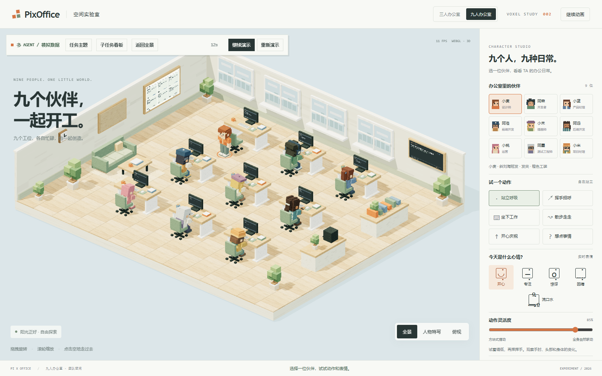
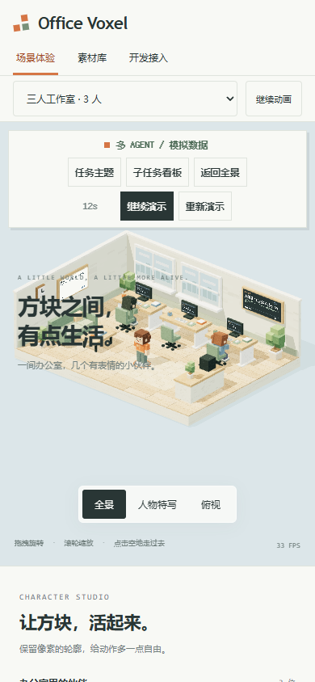
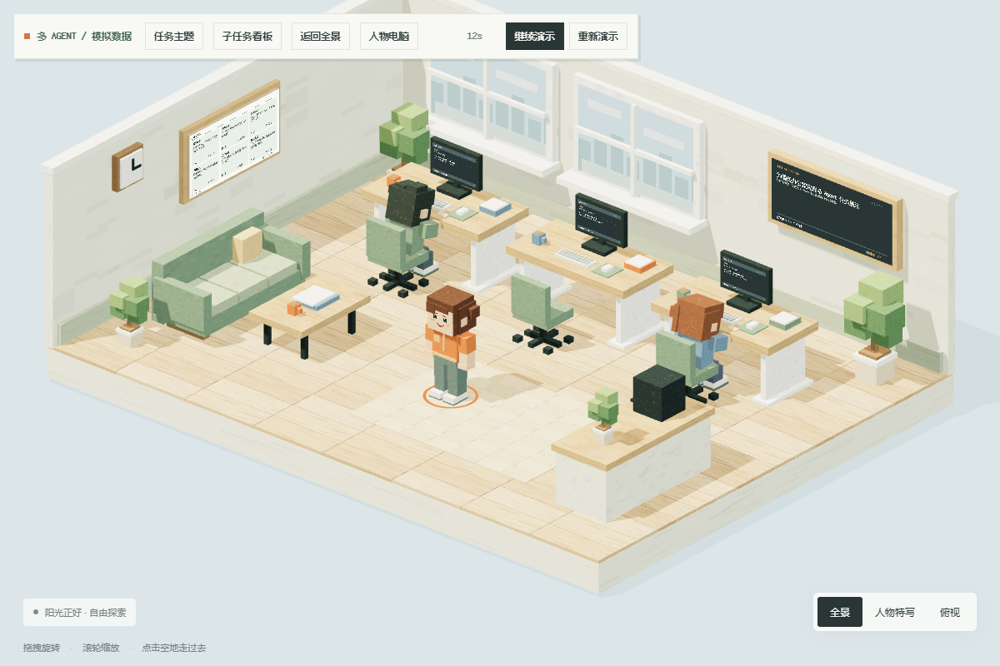
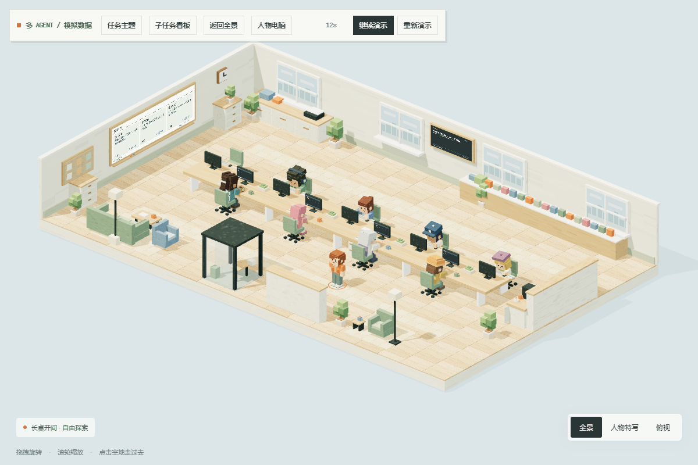
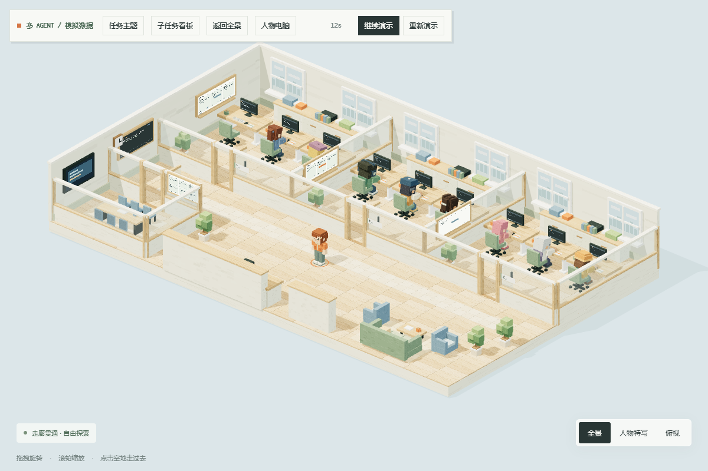
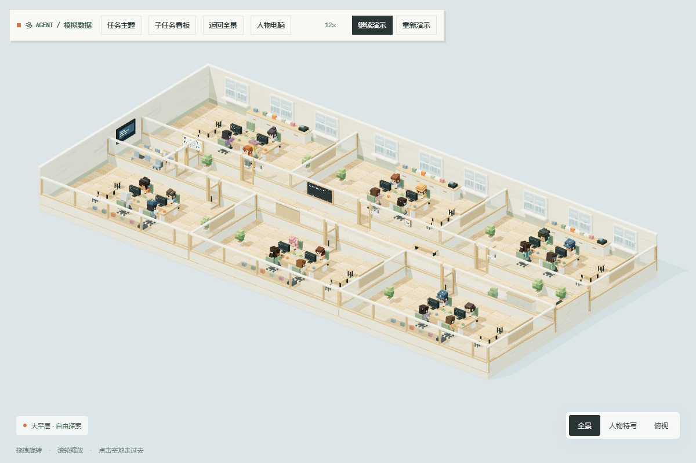
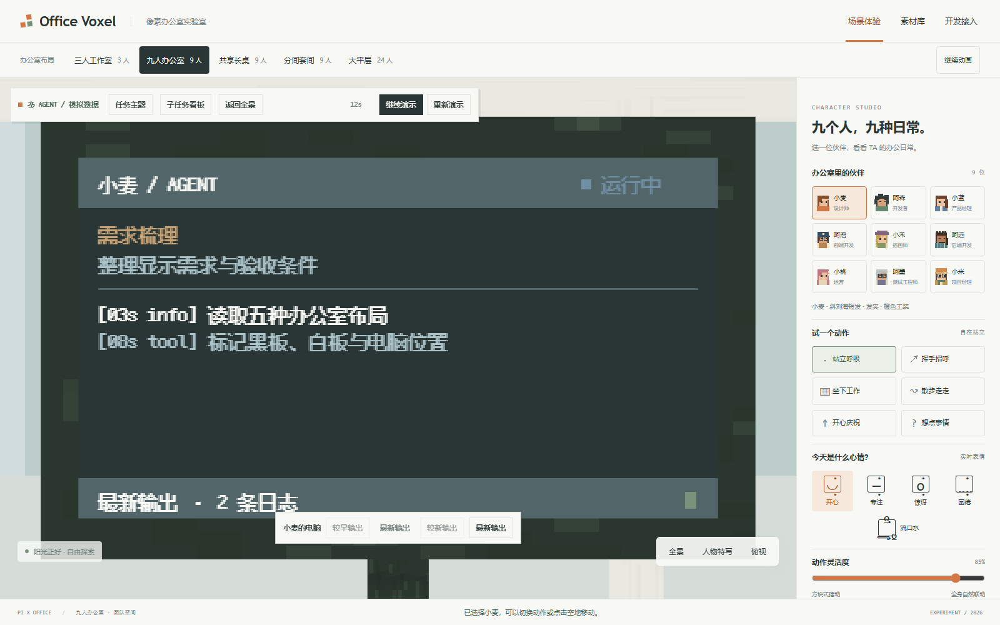
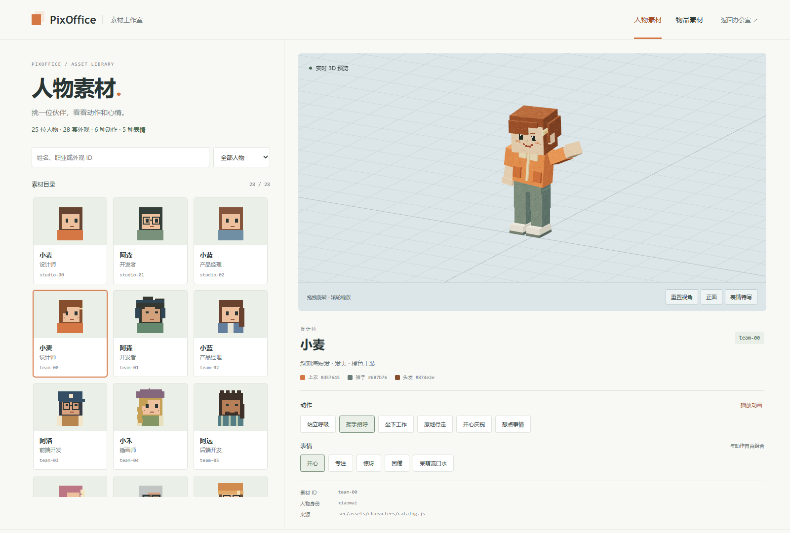
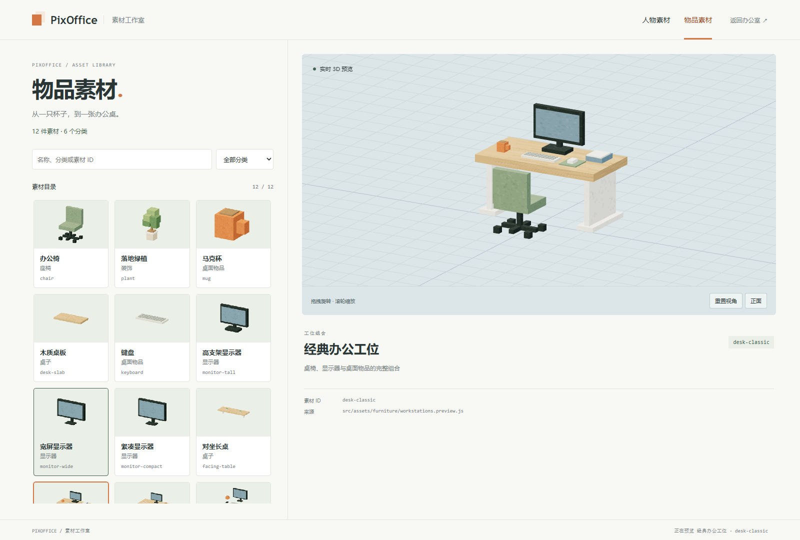
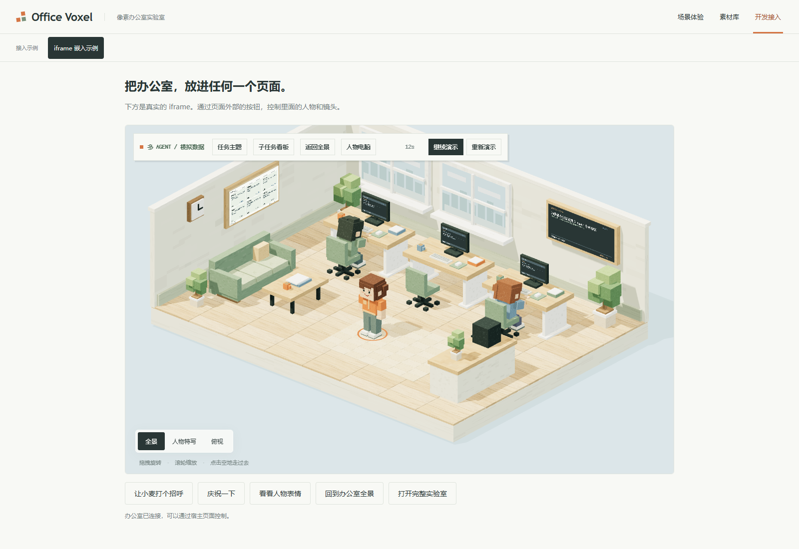

# Office Voxel

**把多 Agent 的协作过程，放进一间看得见的 3D 办公室。**

基于 Three.js、原生 JavaScript ES 模块和 Vite 的浏览器前端。角色在自己的工位工作，黑板展示任务目标，白板展示子任务，每台电脑显示对应 Agent 的操作与日志。模型、关节动画和像素贴图由代码生成，运行时无需外部模型服务或远程 CDN。




> 当前提供可交互的前端演示和模拟任务数据；接入真实 Agent 服务需实现任务数据源接口。本文全部截图于 **2026-10-19** 从当前版本重新拍摄，包含统一导航、手机首屏和 iframe 宿主示例。

## 可以做什么

- **观察协作**：任务主题、子任务看板、独立电脑日志，以及运行、受阻、完成等状态。
- **切换空间**：三人工作室、九人办公室、共享长桌、分间套间、24 人大平层，共用场景引擎。
- **控制人物**：选择角色，切换待机、挥手、打字、走路、庆祝、思考等动作，组合五种表情；点击地面可避开静态家具移动。
- **浏览素材**：人物与物品工作室支持搜索、筛选、旋转缩放、动作预览和素材直达链接。
- **嵌入产品**：使用 iframe 纯场景模式，或通过 `window.PixOfficeVoxel` 控制人物、镜头与任务展示。
- **复用资产**：仓库附带 28 套外观的头像、人物对照图与静态 GLB，支持按人物或文件类型事务更新。

## 快速开始

需要 **Node.js 22.12+** 和支持 **WebGL 2** 的浏览器。在克隆后的仓库根目录运行：

```sh
npm ci
npm run dev
```

打开 [http://127.0.0.1:5196/](http://127.0.0.1:5196/)。顶部统一提供「场景体验」「素材库」「开发接入」三个分区；场景体验下可切换全部五种办公室，窄屏使用选择菜单。拖拽旋转、滚轮缩放；右侧选择人物与动作，触屏支持拖拽与双指缩放。

| 页面 | 路径 | 内容 |
| --- | --- | --- |
| 三人工作室 | `/` | 小型办公室与完整控制面板 |
| 九人办公室 | `/nine.html` | 三排独立工位与团队看板 |
| 共享长桌 | `/loft.html` | 九人双排对坐、环形走道 |
| 分间套间 | `/suite.html` | 九人、三间办公室与会议室 |
| 大平层 | `/floor.html` | 24 人、六间办公室、会议与休息区 |
| 人物工作室 | `/characters.html` | 25 位人物、28 套外观、动作与表情 |
| 物品工作室 | `/objects.html` | 12 件家具与工位素材预览 |
| 嵌入示例 | `/embed.html` | 同源宿主控制 iframe |

## 网站导航与使用

所有完整页面共用两级导航。顶部切换功能分区，下一行显示当前分区的页面；点击左上角 **Office Voxel** 返回三人工作室。

| 顶部入口 | 分区内入口 | 适合做什么 |
| --- | --- | --- |
| 场景体验 | 三人工作室、九人办公室、共享长桌、分间套间、大平层 | 浏览空间、选择人物、观察模拟任务 |
| 素材库 | 人物素材、物品素材 | 搜索和筛选素材，查看外观与 3D 预览 |
| 开发接入 | iframe 嵌入示例 | 体验宿主页面控制人物和镜头 |

**第一次体验**：进入「场景体验」，切换到「九人办公室」；点击「任务主题」和「子任务看板」了解当前任务，再点击人物头像并选择「查看电脑屏幕」，查看这个 Agent 的操作与日志。

**手机上使用**：顶部三个分区直接点击，分区内入口通过下一行的选择菜单切换。办公室选项同时标注布局名称和人数；浏览器后退时，菜单恢复为当前页面。3D 场景支持单指拖动和双指缩放，人物控制面板位于场景下方。



**两个暂停按钮**：「暂停动画」控制人物动作；任务工具栏中的「暂停演示」控制模拟任务播放，任务还可以单独重播。两者独立，暂停人物后仍可观察任务进度。

## 五种办公室

下面四张使用 `?embed=1` 纯场景模式，九人版完整界面见首页大图。

| 三人工作室 | 九人共享长桌 |
| --- | --- |
|  |  |
| **九人分间套间** | **24 人大平层** |
|  |  |

空间布局、工位摆放、碰撞与人物绑定独立于素材构建器。新增布局可复用现有角色、家具和任务展示，具体约定见 [项目架构](docs/architecture.md)。

## 查看 Agent 正在做什么

点击「任务主题」查看目标与进度，点击「子任务看板」查看负责人和状态。点击人物头像，再选择「查看电脑屏幕」，镜头就会对准该 Agent 的固定工位；人物离开座位后，电脑归属保持不变。



内置 74 秒模拟演示，支持暂停、重播和日志翻页。真实数据接入通过 `tasks.setSource(source)` 提供快照、订阅事件和释放方法；可将 SSE 或 WebSocket 消息转换为任务事件。完整接口、事件格式及绑定说明见 [使用与集成指南](docs/usage.md#后端数据接入)。

## 人物与物品工作室

人物身份、外观、场景实例与业务 Agent 使用独立 ID。工作室直接读取素材目录，用同一套构建器生成预览；新增符合目录约定的素材后，开发页面会更新，生产环境需重新构建。





人物导出位于 [`public/assets/characters/`](public/assets/characters/)，共 84 个 PNG/GLB 文件。GLB 是包含材质和脸部纹理的静态快照，动态行为由 JavaScript 提供。运行时继续由代码生成素材，保留 `publicDir: false`。

```sh
# 先保持开发服务运行，在另一个终端执行
npm run export:characters
# 只更新一位人物的头像，保留其他产物
npm run export:characters -- --only=portrait --ids=team-00
```

更多说明：[动态素材工作室](docs/asset-library.md) · [人物导出](docs/character-assets.md) · [素材管理](docs/material-management.md)。

## 嵌入与部署

在办公室页面地址后加 `?embed=1`，即可嵌入纯场景视图：

```html
<iframe
  src="/voxel-office/nine.html?embed=1"
  title="Office Voxel 九人办公室"
  style="width:100%;height:640px;border:0"
></iframe>
```

同源父页面可通过结构化 `postMessage` 控制人物、动作、表情和镜头。完整宿主示例见 [`embed.html`](embed.html)，消息格式见 [嵌入指南](docs/usage.md#嵌入)。

从顶部「开发接入」进入示例后，使用 iframe 下方的按钮让人物挥手、庆祝或切换镜头。iframe 内的 `?embed=1` 模式隐藏网站导航和人物面板，保留 3D 场景、任务工具栏与镜头操作。



```sh
npm run build
npm run preview
```

主构建输出到 `dist/`，包含五种办公室、人物、物品和嵌入示例，共八个页面；预览地址为 [http://127.0.0.1:5197/](http://127.0.0.1:5197/)。长桌、套间和大平层仍可分别运行 `npm run build:loft`、`npm run build:suite`、`npm run build:floor`，输出到各自的 `dist-*` 目录；这些独立构建仅显示实际包含的页面入口。构建使用相对资源路径，可部署到静态网站子目录；请通过 HTTP 服务访问。

发布完整网站时上传 **整个 `dist/` 目录的内容**，包含八个 HTML 和共用的 `assets/` 等文件，不需要再合并三个独立构建。部署到 `/voxel-office/` 等子目录后，从该目录的 `index.html` 进入，导航沿用相对路径。

## 开发与验证

| 目录 | 职责 |
| --- | --- |
| `src/app/` | 页面入口、控制面板与样式 |
| `src/engine/` | 渲染、镜头、人物控制、寻路与生命周期 |
| `src/world/`、`src/layouts/` | 场景组装、碰撞、工位契约与五种布局 |
| `src/assets/` | 人物、家具、环境、材质与内置字体 |
| `src/integrations/` | 任务数据、3D 展示与 iframe 适配 |
| `src/tools/`、`scripts/`、`tests/` | 素材工作室、导出与自动化验证 |

网站页面名称、URL、分区和人数统一维护在 [`src/app/site-pages.js`](src/app/site-pages.js)。共享导航在 Vite 处理 HTML 时生成；增加网站入口时，同时注册页面并在 HTML 中保留导航挂点。布局数据仍由 `src/layouts/registry.js` 独立维护，具体流程见[项目架构](docs/architecture.md#网站导航与构建入口)。

```sh
npm test
npm run build
npx playwright install chromium
# 终端一：稳定浏览器测试服务
node scripts/browser-serve.mjs
```

在另一个 PowerShell 终端执行：

```powershell
$env:DEMO_URL = 'http://127.0.0.1:5206/'
npm run test:browser
npm run test:browser:navigation
npm run test:browser:assets
npm run test:browser:tasks
```

场景变更的完整回归要求见 [贡献指南](AGENTS.md)。导航专项检查涵盖八页入口、320–1440px 响应式、手机菜单切换与后退状态、iframe 控制和纯场景模式。测试截图与报告写入忽略的 `.artifacts/`。

README 的十张实机截图保存在 `docs/images/`。安装 Playwright Chromium 后，运行 `node scripts/capture-readme.mjs` 可一次重新拍摄全部图片；脚本会自行启动并关闭 5208 端口的临时服务，检查导航、页面溢出和浏览器错误。更新截图后，同步修改本文的拍摄日期，并将图片与文档一起提交。

## 当前边界

这是多 Agent 协作可视化的前端原型。尚未包含真实 Agent 执行后端、身份认证或持久化。角色使用程序化关节动画，寻路处理静态家具避障，暂不处理人物之间的动态避让；性能与兼容性仍需在目标设备上验证。

## 许可证

项目代码与本项目提供的程序化人物、家具、环境及 PNG/GLB 素材采用 [MIT License](LICENSE)。素材范围与第三方例外见 [素材许可](ASSET_LICENSE.md)。

项目从 PixOffice 的 Office Voxel 示例迁出，保留原作者 teejoo 的 MIT 声明。Three.js、Fusion Pixel 字体与构建工具的原始版权和许可见 [第三方声明](THIRD_PARTY_NOTICES.md)；字体继续采用 OFL 1.1。生产构建及人物素材导出包均随附许可文件。
